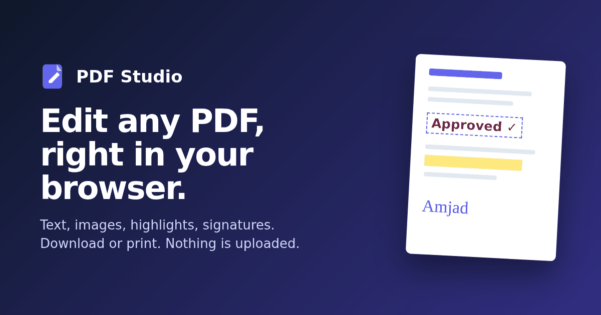

# PDF Studio

[](LICENSE)
[](https://github.com/mrxdevs/pdf-studio/actions/workflows/pages.yml)
[](https://github.com/mrxdevs/pdf-studio/actions/workflows/test.yml)
[](CONTRIBUTING.md)
[](https://github.com/mrxdevs/pdf-studio/labels/good%20first%20issue)
[](https://github.com/mrxdevs/pdf-studio/stargazers)

**A free, open-source PDF editor that runs entirely in your browser.** Add and edit text, sign, insert images, highlight and rearrange pages, then download or print. Your file is never uploaded anywhere.

**Live: https://pdfstudio.mrxamjad.com**



## Features

- **Add text**: 7 fonts (Helvetica, Times, Courier, Poppins, Lato, Great Vibes, Pacifico), size, color, bold / italic / underline, alignment, background color
- **Edit existing text**: tap a line in the PDF to cover it and retype it in a matching color and size
- **Sign**: draw by hand, type in a signature font, or insert a signature image
- **Images**: PNG / JPG (other formats converted), move, resize, opacity
- **Markup**: whiteout, highlight, rectangles, freehand drawing
- **Pages**: rotate, delete, reorder, add blank pages, thumbnails, zoom
- **Output**: download a real PDF (vector text, embedded fonts and images), print, or share on mobile
- Undo / redo, keyboard shortcuts, touch-friendly on phones, password-protected PDFs

## Privacy

Everything runs client-side with [pdf.js](https://mozilla.github.io/pdf.js/) and [pdf-lib](https://pdf-lib.js.org/). There is no backend, no account, no analytics. The page loads its open-source libraries and some fonts from a public CDN; your document is never sent anywhere. You can verify this in your browser's Network tab or by reading the code.

## Guides

- [How to edit text in a PDF](https://pdfstudio.mrxamjad.com/how-to-edit-text-in-pdf/)
- [How to sign a PDF for free](https://pdfstudio.mrxamjad.com/how-to-sign-pdf-free/)
- [How to add an image to a PDF](https://pdfstudio.mrxamjad.com/add-image-to-pdf/)
- [Why a private, no-upload PDF editor matters](https://pdfstudio.mrxamjad.com/private-pdf-editor-no-upload/)

## Run locally

```bash
git clone https://github.com/mrxdevs/pdf-studio.git
cd pdf-studio
python3 -m http.server 8080 -d site   # or: npx serve site -l 8080
# open http://localhost:8080
npm test                              # Node 18+, no dependencies
```

The site is plain HTML, CSS and JavaScript in `site/` with no build step. Every push to `main` is deployed to GitHub Pages by `.github/workflows/pages.yml`.

## Known limitations

- Edited text uses the closest built-in font, not the PDF's original embedded font
- Indian scripts (Devanagari, Tamil and others) can't be typed correctly yet
- No offline / installable (PWA) mode yet
- Bookmarks may be lost when pages are reordered

Each of these is an open issue, and help is welcome.

## Contributing

Contributions are welcome: bug reports, ideas, docs, translations and code.

1. Read the [contributing guide](CONTRIBUTING.md) (local setup, tests, PR flow).
2. Pick an issue labelled [`good first issue`](https://github.com/mrxdevs/pdf-studio/labels/good%20first%20issue), or open one to discuss your idea.
3. Fork, branch, make a focused change, run `npm test`, and open a pull request.

Please follow the [Code of Conduct](CODE_OF_CONDUCT.md). Found a security problem? See [SECURITY.md](SECURITY.md).

## License

[MIT](LICENSE) © 2026 Amjad Ali

## Credits

Designed and developed by **Amjad Ali**: mobile and web developer, Chennai.

- Website: [mrxamjad.com](https://mrxamjad.com)
- GitHub: [@mrxdevs](https://github.com/mrxdevs)
- LinkedIn: [in/mrxamjad](https://www.linkedin.com/in/mrxamjad)
- X: [@MrxAmjad](https://x.com/MrxAmjad)
- Instagram: [@mrxamjad](https://instagram.com/mrxamjad)
- Medium: [@mrxamjad](https://medium.com/@mrxamjad)

If you use or fork this project, a link back is appreciated.
