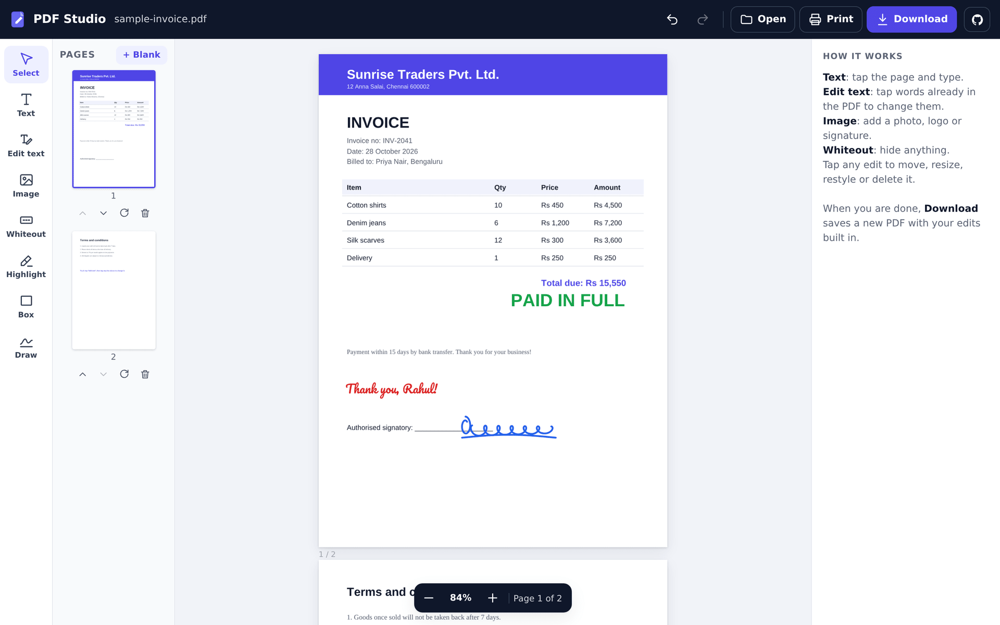
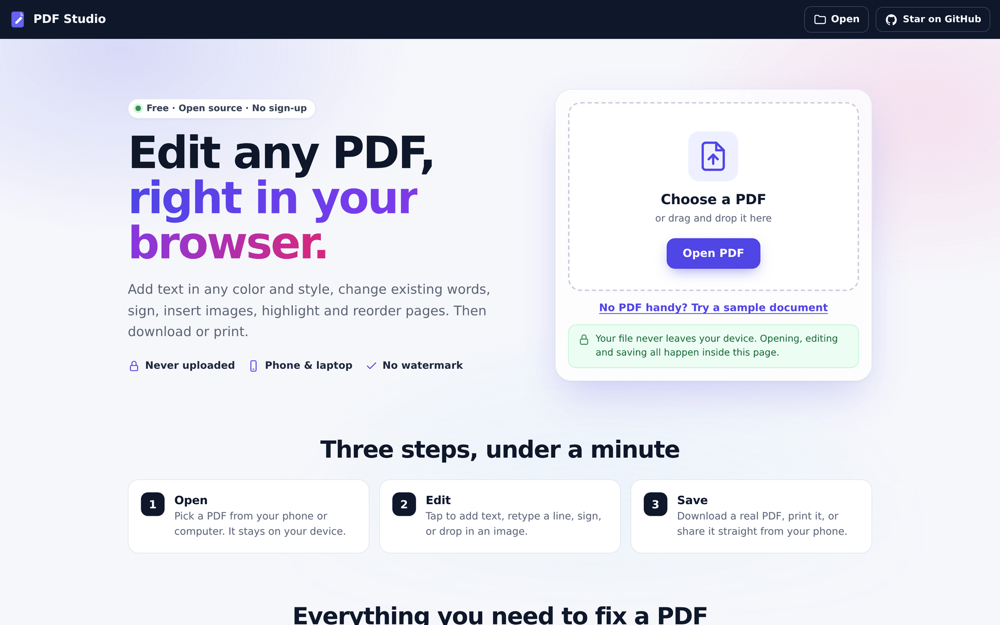
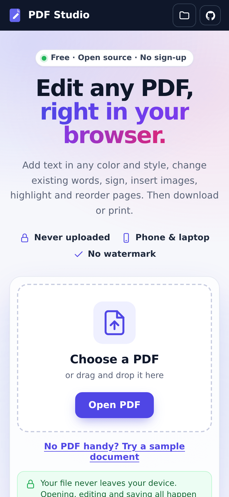
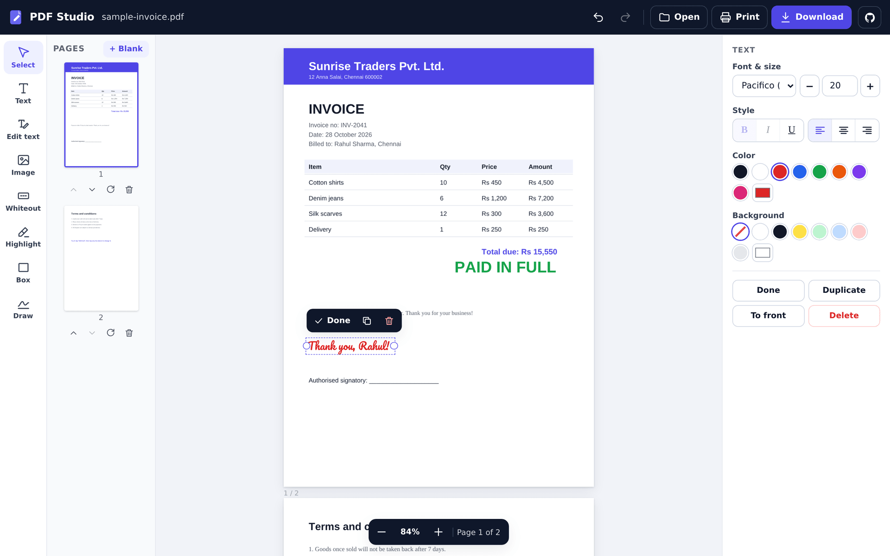
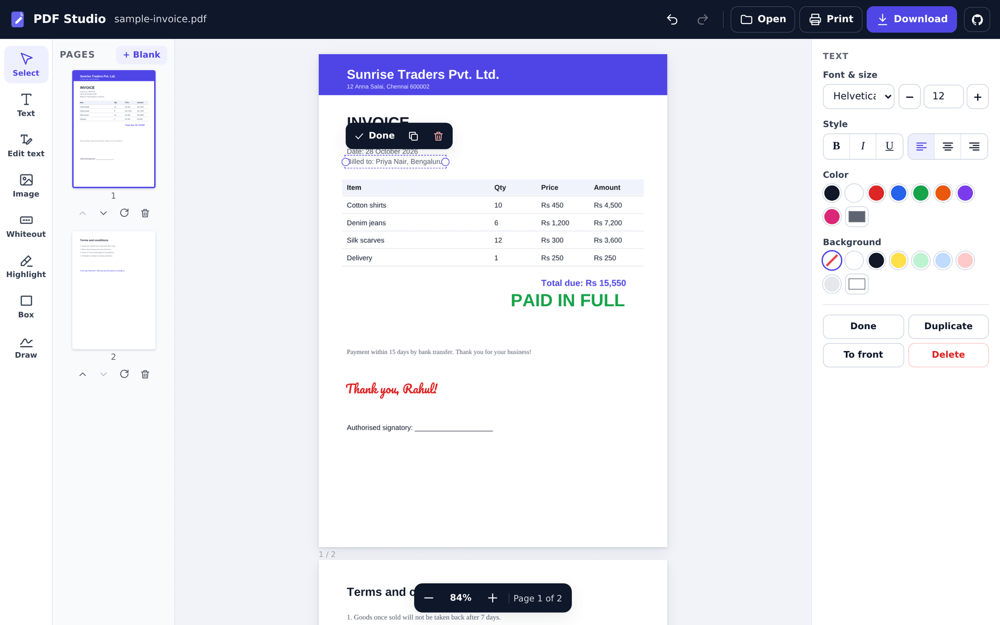
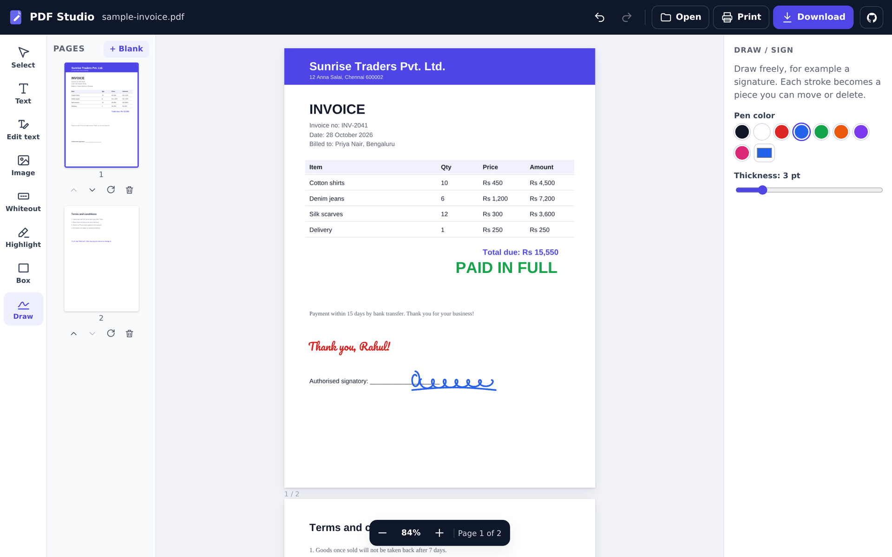
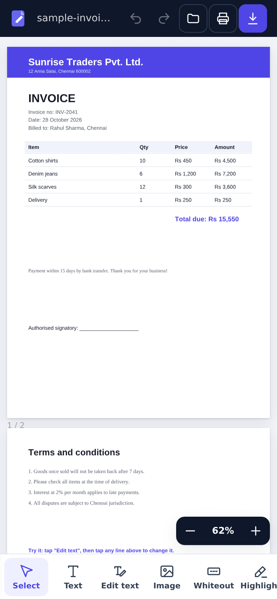
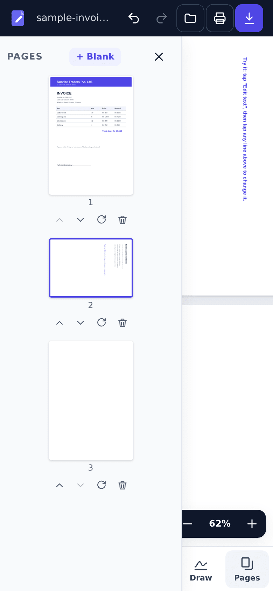

<div align="center">

<a href="https://pdfstudio.mrxamjad.com">
  
</a>

# PDF Studio

### ✍️ Edit, sign and fill PDFs right in your browser. Your file never leaves your device.

Free and open source. No sign-up, no upload, no watermark.

[](LICENSE)
[](https://pdfstudio.mrxamjad.com)
[](https://github.com/mrxdevs/pdf-studio/stargazers)
[](CONTRIBUTING.md)
<br>
[](https://github.com/mrxdevs/pdf-studio/actions/workflows/pages.yml)
[](https://github.com/mrxdevs/pdf-studio/actions/workflows/test.yml)
[](https://mozilla.github.io/pdf.js/)
[](https://pdf-lib.js.org/)
[](https://github.com/mrxdevs/pdf-studio/labels/good%20first%20issue)

**[🌐 Open PDF Studio](https://pdfstudio.mrxamjad.com)** &nbsp;·&nbsp;
**[📸 Screenshots](#-screenshots--demo)** &nbsp;·&nbsp;
**[🐛 Report a bug](https://github.com/mrxdevs/pdf-studio/issues/new/choose)** &nbsp;·&nbsp;
**[💡 Request a feature](https://github.com/mrxdevs/pdf-studio/issues/new/choose)**

<br>

<a href="https://pdfstudio.mrxamjad.com">
  
</a>

</div>

---

## 📖 Table of contents

- [✨ Features](#-features)
- [📸 Screenshots & Demo](#-screenshots--demo)
- [🚀 Quick start](#-quick-start)
- [🛠️ Tech stack](#️-tech-stack)
- [📁 Project structure](#-project-structure)
- [🔒 Privacy](#-privacy)
- [⚠️ Known limitations](#️-known-limitations)
- [🗺️ Roadmap](#️-roadmap)
- [🤝 Contributing](#-contributing)
- [📄 License](#-license)
- [👨‍💻 Author](#‍-author)

---

## ✨ Features

PDF Studio is a complete PDF editor that runs 100% client-side. Open a file, make your changes, and download a real PDF with the edits built in.

| | Feature | What you can do |
|:-:|---|---|
| 📝 | **Add text** | Tap anywhere and type. 7 fonts (Helvetica, Times, Courier, Poppins, Lato, Great Vibes, Pacifico), size, colour, **bold** / *italic* / <u>underline</u>, alignment and background colour |
| ✏️ | **Edit existing text** | Tap a line already in the PDF. It is covered in the page's own colour and becomes a text box with the same words, colour and size, ready to retype |
| ✍️ | **Sign** | Draw your signature by hand, type it in a signature font, or insert a scanned signature image |
| 🖼️ | **Images** | Add PNG / JPG (other formats are converted). Move, resize with aspect lock, adjust opacity |
| 🖍️ | **Markup** | Whiteout, highlight, boxes with borders and freehand drawing |
| 📄 | **Pages** | Thumbnails, rotate, delete, reorder, add blank pages, zoom |
| 💾 | **Export** | Download a real PDF (vector text, embedded fonts and images) as `name-edited.pdf`, print it, or share it from your phone |
| ↩️ | **Undo / redo** | Full history, plus duplicate, bring to front and keyboard shortcuts on desktop |
| 📱 | **Mobile ready** | Touch drag and resize, a bottom style sheet and a slide-out pages panel on phones |
| 🔐 | **Protected PDFs** | Password-protected files ask for their password and open locally |
| 🔒 | **Private by design** | No server, no account, no analytics. Your document never leaves the browser tab |
| 🆓 | **Free & open source** | MIT licensed, no watermark, no limits |

---

## 📸 Screenshots & Demo

### 🎬 Demo: open a PDF, add text, download

<div align="center">
  
</div>

### 🏠 Landing page

<table>
  <tr>
    <td width="72%" align="center"><br><sub><b>Desktop</b> (1440 px)</sub></td>
    <td width="28%" align="center"><br><sub><b>Phone</b> (390 px)</sub></td>
  </tr>
</table>

### 📝 Add coloured, styled text

Pick a font, size and colour, then tap the page and type. Every text box can be moved, resized, restyled or deleted.



### ✏️ Edit text that is already in the PDF

With **Edit text**, tap any line. Here "Billed to: Rahul Sharma, Chennai" was replaced with "Billed to: Priya Nair, Bengaluru".



### ✍️ Draw a signature



### 📱 On your phone

<table>
  <tr>
    <td width="50%" align="center"><br><sub><b>Editor</b></sub></td>
    <td width="50%" align="center"><br><sub><b>Pages panel</b>: rotate, reorder, delete, add</sub></td>
  </tr>
</table>

---

## 🚀 Quick start

### Use it online

👉 **[pdfstudio.mrxamjad.com](https://pdfstudio.mrxamjad.com)**: open a PDF (or tap **Try a sample document**), edit, then **Download**.

### Run it locally

No build step and no dependencies. It is plain HTML, CSS and JavaScript.

```bash
git clone https://github.com/mrxdevs/pdf-studio.git
cd pdf-studio

# serve the site/ folder with any static server
python3 -m http.server 8080 -d site     # or: npx serve site -l 8080

# open http://localhost:8080
```

### Run the tests

```bash
npm test     # Node 18+, uses the built-in node:test runner, nothing to install
```

### Deploy

Every push to `main` is deployed to GitHub Pages by [`.github/workflows/pages.yml`](.github/workflows/pages.yml). To host your own copy, fork the repo and enable **Settings → Pages → Source: GitHub Actions**, or upload `site/` to any static host.

### ⌨️ Keyboard shortcuts (desktop)

| Key | Tool | | Shortcut | Action |
|:-:|---|---|:-:|---|
| `V` | Select | | `Ctrl/⌘ + Z` | Undo |
| `T` | Text | | `Ctrl/⌘ + Shift + Z` or `Ctrl/⌘ + Y` | Redo |
| `E` | Edit text | | `Ctrl/⌘ + S` | Download |
| `I` | Image | | `Ctrl/⌘ + P` | Print |
| `W` | Whiteout | | `Delete` / `Backspace` | Delete selection |
| `H` | Highlight | | `Arrow keys` (+ `Shift`) | Nudge selection 1 pt (10 pt) |
| `R` | Box | | `Enter` | Edit the selected text |
| `D` | Draw / sign | | `Esc` | Deselect / finish editing |

---

## 🛠️ Tech stack

| Layer | Technology |
|---|---|
| 🖥️ Rendering | [pdf.js](https://mozilla.github.io/pdf.js/) by Mozilla: draws pages and reads the text layer for "Edit text" |
| 🧾 Writing | [pdf-lib](https://pdf-lib.js.org/): bakes text, images and shapes into a real PDF |
| 🔤 Fonts | [fontkit](https://github.com/foliojs/fontkit) for embedding, plus Poppins, Lato, Great Vibes, Pacifico, and Arimo / Tinos / Cousine for on-screen previews of the standard PDF fonts |
| 🎨 UI | Vanilla JavaScript, HTML and CSS. No framework, no bundler |
| ✅ Tests | Node's built-in `node:test` runner |
| ☁️ Hosting | GitHub Pages via GitHub Actions, custom domain |

---

## 📁 Project structure

```text
pdf-studio/
├── site/                          # 🌐 the whole app (deployed as-is)
│   ├── index.html                 #    landing page + editor
│   ├── app.js                     #    editor logic: render, tools, export
│   ├── styles.css                 #    styles (desktop + mobile)
│   ├── favicon.svg / og.png       #    logo and social preview image
│   ├── fonts/                     #    bundled fonts
│   ├── how-to-edit-text-in-pdf/   #    📚 guides (SEO pages)
│   ├── how-to-sign-pdf-free/
│   ├── add-image-to-pdf/
│   ├── private-pdf-editor-no-upload/
│   ├── about/
│   ├── robots.txt / sitemap.xml   #    search engines
│   └── llms.txt / llms-full.txt   #    AI assistants
├── test/site.test.js              # ✅ tests
├── docs/screenshots/              # 📸 README images
├── .github/
│   ├── workflows/                 # ⚙️ pages.yml (deploy), test.yml (CI)
│   ├── ISSUE_TEMPLATE/            #    bug and feature templates
│   └── PULL_REQUEST_TEMPLATE.md
├── CONTRIBUTING.md · CODE_OF_CONDUCT.md · SECURITY.md · LICENSE
└── package.json
```

---

## 🔒 Privacy

> **Your PDF never leaves your device.**

- 🚫 **No upload.** Files are opened with the browser's File API and processed in memory, in the tab.
- 🚫 **No backend, no account, no analytics, no cookies.**
- 🌐 The page only loads its open-source libraries and some fonts from a public CDN. Your document is never sent anywhere.
- 🔍 **Verify it yourself:** open DevTools → **Network**, edit a file, and watch: no request carries your document. Or read the code, it's all in [`site/app.js`](site/app.js).

📚 More on this: [Why a private, no-upload PDF editor matters](https://pdfstudio.mrxamjad.com/private-pdf-editor-no-upload/)

### 📚 Guides

- [How to edit text in a PDF](https://pdfstudio.mrxamjad.com/how-to-edit-text-in-pdf/)
- [How to sign a PDF for free](https://pdfstudio.mrxamjad.com/how-to-sign-pdf-free/)
- [How to add an image to a PDF](https://pdfstudio.mrxamjad.com/add-image-to-pdf/)
- [Why a private, no-upload PDF editor matters](https://pdfstudio.mrxamjad.com/private-pdf-editor-no-upload/)

---

## ⚠️ Known limitations

- Edited text uses the closest built-in font, not the PDF's original embedded font
- Indian scripts (Devanagari, Tamil and others) can't be typed correctly yet
- No offline / installable (PWA) mode yet
- Bookmarks may be lost when pages are reordered

Each of these is an open issue, and help is welcome. 🙌

---

## 🗺️ Roadmap

| # | Item | Status |
|:-:|---|---|
| [#1](https://github.com/mrxdevs/pdf-studio/issues/1) | 🇮🇳 Support typing Indian scripts (Devanagari, Tamil and others) | 🟡 Open, help wanted |
| [#2](https://github.com/mrxdevs/pdf-studio/issues/2) | 📴 Offline support: make PDF Studio an installable PWA | 🟢 Good first issue |
| [#3](https://github.com/mrxdevs/pdf-studio/issues/3) | 🔖 Keep bookmarks (outline) when pages are reordered or deleted | 🟢 Good first issue |
| [#4](https://github.com/mrxdevs/pdf-studio/issues/4) | 🔤 True in-place editing: match the original font when editing existing text | 🟡 Open, help wanted |
| [#5](https://github.com/mrxdevs/pdf-studio/issues/5) | 🍎 Test on iPhone Safari and fix touch / download issues | 🟢 Good first issue |

Have an idea? [Open an issue](https://github.com/mrxdevs/pdf-studio/issues/new/choose) or start a thread in [Discussions](https://github.com/mrxdevs/pdf-studio/discussions). All open work: [issues](https://github.com/mrxdevs/pdf-studio/issues).

---

## 🤝 Contributing

Contributions of every size are welcome: bug reports, ideas, docs, translations and code. 💜

1. 📖 Read the **[contributing guide](CONTRIBUTING.md)** (local setup, tests, PR flow).
2. 🔍 Pick an issue labelled [`good first issue`](https://github.com/mrxdevs/pdf-studio/labels/good%20first%20issue), or open one to discuss your idea.
3. 🍴 Fork, create a branch, and make a focused change.
4. ✅ Run `npm test` and check your change in a desktop and a phone-sized browser.
5. 🚀 Open a pull request and describe what you changed and why.

Please follow the [Code of Conduct](CODE_OF_CONDUCT.md). Found a security problem? See [SECURITY.md](SECURITY.md).

⭐ **If PDF Studio is useful to you, please star the repo.** It helps other people find it.

---

## 📄 License

Released under the [MIT License](LICENSE). © 2026 Amjad Ali.

You can use, modify and distribute it freely, including commercially. A link back is appreciated.

---

## 👨‍💻 Author

<div align="center">

### Amjad Ali

Mobile & web developer · Chennai, India 🇮🇳

Designed and built PDF Studio.

[](https://mrxamjad.com)
[](https://github.com/mrxdevs)
[](https://www.linkedin.com/in/mrxamjad)
<br>
[](https://x.com/MrxAmjad)
[](https://instagram.com/mrxamjad)
[](https://medium.com/@mrxamjad)

<br>

Made with ❤️ in Chennai · **[pdfstudio.mrxamjad.com](https://pdfstudio.mrxamjad.com)**

<a href="#pdf-studio">⬆️ Back to top</a>

</div>
